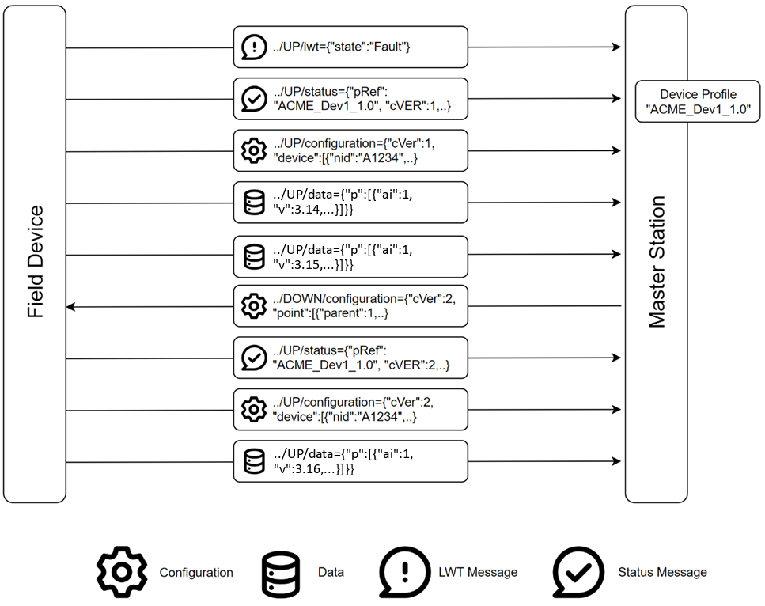
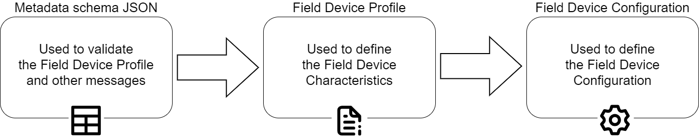

# Data model

Communications are defined between an SA and FDs that can use any software or hardware architecture. Multiple SAs and FDs are possible on the same system.

## Field device

A Field Device is a piece of equipment that is monitoring or controlling one or more physical assets. Each asset may have one or more attributes that the FD is monitoring or controlling.

Examples of this are:

- A pressure sensor on a pipe monitoring the pressure in the pipe.

- A sensor monitoring a water meter recording water flow over time.

- An FD controlling the switch on a water pump.

FDs have sensor inputs and outputs called points that can be individually configured, read, and recorded. Points each have a set of configuration data, often with a wide array of attributes, describing the capabilities of the point or asset being monitored and controlled.

Changes of point values, states and other things can occur within the FD. The protocol allows actions to be associated with these changes on the FD. The actions may cause the generation of events so that the SA can be informed of the changes. Typical FD changes can be for example:

- A monitored point may record a value that is greater than a predefined limit.

- An internal timer in the FD may trigger.

- An external sensor may become inoperative.

FD actions may include recording the issue or event or triggering a communications operation.

Every FD MUST have a Universally Unique Identifier (UUID). This is so that every Lucid device can be uniquely identified, regardless of communications medium or site location. The UUID MUST be initially set with a globally unique string by a device vendor.

Figure 1 shows a series of messages between an FD and an SA, with a Broker as intermediary.

For more information, see Section [11](../11-example-use-cases.md#example-use-cases), [Example use cases](../11-example-use-cases.md#example-use-cases) for sample message content.

The FD creates a connection, delivering an LWT message to the Broker, which holds that message for delivery to the SA in the event of unexpected disconnection of the FD.

For more information, see Section [6](../06-use-of-mqtt.md#use-of-mqtt), [Use of MQTT](../06-use-of-mqtt.md#use-of-mqtt) which describes session and online status.

The FD sends status and configuration messages to the SA, enabling the SA to set up the device signals, and properties, in its database. To do this it refers to the FD Profile for that FD type. The FD profile and configuration message may optionally be sent from FD to SA. Where the FD profile and/or configuration message is not sent by the FD, it could be sent by a third party to the same Topic.

By omitting the FD Profile and configuration messages, lower device bandwidth requirements can be achieved.

The FD sends data messages to the SA. These are unsolicited and controlled by configuration properties and FD behaviour. The FD has a queue of data items to be sent via the Broker. There is a Topic and Payload available for the SA to request data, and such data requests are also queued.

The FD delivers all queued data to the SA via the Broker, when a connection is established, controlled by schedules, and defined actions. While data may be marked by such event priorities, all data is delivered in the queued order.

The SA can update FD configuration by sending some or all configuration properties, as defined by the FD Profile. These result in a new status message from the FD and a new full configuration message, confirming the changes. A property of the configuration message states whether the message contains the complete configuration or just part.

### Lucid schema

The content of all Lucid messages is laid out according to a schema using the JSON Schema format as shown in the JSON code file: **lucid.schema.json**.

This schema defines the necessary fields for each type of message, In the case of the objects and fields in the profile, the schema defines the structure but not each individual field.

