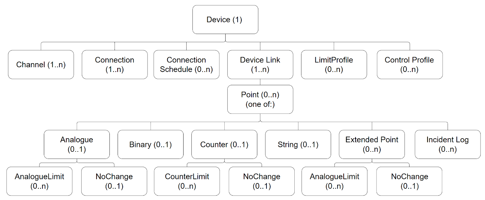

### Device profile

The FD Profile describes the capability of the device, and how and what can be configured. It is a JSON document that can be used by the SA to determine what configuration can be used with the specific FD.

The FD Profile specifies the available upload/download characteristics, the device features, and the allowable properties for each element of the configuration. It also contains hardware version and manufacturer information.

The FD Profile can either be sent from the device or referred to by a unique reference (preferred) where the profile has previously been uploaded to the SA. The FD Profile is pre-loaded into the SA, as there can be many FDs sharing the same profile.

The FD sends the Device Profile, or reference, on first connection to the MQTT Broker and afterwards on request. First connection is determined by the FD.

If referred to by a unique reference, the SA retains the Device Profile and creates or interprets FD configuration messages accordingly.

The unique reference is a string containing the manufacturer name, device (product) name and the version number, each separated by underscores and with no full stops. When an FD Profile reference is received by the SA, it can find the FD Profile from preloaded files.

The JSON code file, **Field Device Profile.json,** supplied with the Lucid specification defines a typical fully featured FD Profile. Not all features of this FD Profile are required by an FD; types and fields can be omitted. The specific Device Profile for an FD describes all the features available on the device, relevant to its type, and the capability (capacity) of its signals and communications. Only properties listed in the FD Profile may be included in the FD configuration.

The FD Profile Topic name is:

\[UUID\]/UP/profile

The QoS is 1, RETAIN is 1.

#### Customising the field device profile

The **Field Device Profile.json** file, supplied with the Lucid specification, can be modified for an FD implementation as follows:

- Change the Profile Reference pRef field to uniquely identify the profile.

- Change or remove parts of the capability section which describes the supported commands, compression, and quantities of items, and specifically named items such as channels or device links.

- Remove any complete object type definitions from the objectTypes section.\
  For example, an FD may not support counters or alarm limit profiles, so these sections are omitted.

- Remove any configuration fields from the configFields section.\
  For example, an FD may not support chatter detection on points, so the whenChatter field is omitted.

- Remove any extension point types (or the whole extension point scheme) if not supported.

- Add any product-specific objects and tables using a manufacturer-specific naming scheme.

The following sections describe each part of the FD Profile.

#### Field device profile: field device version information

This lists the Lucid version, product name and manufacturer version, and the capabilities for upload and download of core and configuration.

```json
  "lucid": 3,              // Protocol version
  "pRef": "ACME_Dev1_1-1", // These three fields uniquely define the device
                           // profile. By convention the profile name is the
                           // manufacturer name, device name and version
                           // identification in that order, separated by
                           // underscores. E.g. " ACME_Dev1_1-1". This is used in
                           // the status message. Avoid using periods or other
                           // characters not commonly used in filenames.
  "canCoreUp": false,      // Whether Core files can be uploaded/downloaded
  "canCoreDown": false,
  "canConfigDown": true,   // Whether the device can receive configuration
```

The Device Profile is then divided into a Capability section and an Object Types section. These define the general capabilities of the FD, and the quantities and addressing for a collection of objects which make up the FD configuration.

The remainder of the Device Profile is arranged to allow the SA to create the user interface and database structures, to store and edit or view configuration, and to upload or download the resulting configuration derived from the Device Profile.

The Device Profile is also designed to allow manufacturer-specific fields to be identified, so that new, device specific features can be added. It also allows extensibility of the Device Profile standard features without having to create new SA software to support FD features.

#### Field device profile section: field device capability

These items are present to inform the SA how many objects of each type can be configured and how they are to be addressed.

Points

- An array of objects indicating each point type and quantity.

- The list of points denotes physical capability, but not all points need to be configured or used.

- Points may be wired interfaces to other devices or virtual in software. This is device specific.

- An array of types and numbers is used. It is verbose, but simple and flexible.

- Numbers can be 0 or any positive integer.

- Number ranges across types are not unique, so that, for example, there can be analogue input 1 and analogue output 1.

- Point IDs are unique across device links. That is, you cannot have AI0 in two different device links. Device links are just collections of points.

For example:

```json
  "body": {
    "capability": {
      "points": {
        "ai": [
          {
            "from": 1,
            "to": 2
          },
          {
            "from": 6,
            "to": 8
          }
        ],
```

This defines the available ranges for analogue input points: 1, 2, 6, 7 and 8.

Channels

This lists the channel numbers available for a named channel. Numbers can be 0 or any positive integer. Each channel represents a single physical interface by which the Broker can be reached. As an example, the following shows a device which has an ethernet and mobile channel defined. The name and implementation of a channel are device specific. The name is expected to be indicative of the channel's nature. Each channel can support multiple connections.

```json
      "channels": [
        {
          "name": "Ethernet 1",
          "num": 1
        },
        {
          "name": "GPRS",
          "num": 2
        }
      ],
```

The FD only ever communicates with a single Broker system. The exact configuration of the Broker system is up to the user. Multiple channels and connections allow some redundancy in the method of connection to the single Broker system. As there is only a single Broker system, the FD need only maintain a single store of messages for that Broker system.

Once messages are available at the Broker, multiple SAs can subscribe to the messages and receive them.

Field device links

A Field Device Link enables an FD to organise its points into sets. Typically, these sets share the same method of access. For example, there may be physical I/O on the FD, plus a separate capability to link to a Modbus I/O connection or a rack of I/O cards. This section names and assigns numbers to the FD Links. Device Link names can be any text. Numbers can be 0 or any positive integer.

```json
      "deviceLinks": [
        {
          "name": "Internal",
          "num": 0
        },
        {
          "name": "Onboard",
          "num": 1
        },
        {
          "name": "PLC1",
          "num": 2
        },
        {
          "name": "Calc",
          "num": 3
        }
      ],
```

Commands

This denotes what the SA can send to perform actions on Devices with this Device Profile. For example, getdata (manual retrieval of data) and setclock (SA set of clock). If the SA sends these request types, then the FD will respond.

```json
      "commands": [
        "getdata",
        "setclock",
        "control",
        "override",
        "getdeviceinfo"
      ]
```

#### Field device profile section: object types

The Object Types section of the FD Profile details objects and their fields which can be configured within the configuration messages. They define how configuration messages are formed.

```json
"objectTypes": [
```

For further information about forming the Configuration message, see Section [2.1.3](02-configuration.md#configuration), [Configuration](02-configuration.md#configuration).

The range of items permitted within the Field Device Profile is described in the JSON schema document, enabling the SA to self-configure its database schema for new features. To do this the protocol uses some commonly used conventions in JSON libraries for consistency, for example a form library [http://schemaform.io](http://schemaform.io) and JSON schema definitions in [http://json-schema.org](http://json-schema.org).

The object types are listed in the profile as a series of arrays. However, their meaning is explained as a hierarchy, and within each object there are references to related objects. Figure 3 shows the structure of the object types, with the relationships and cardinality between objects. That is, (1) means 'one of' and (0..n) means 'zero or more'.

| NOTICE | These numbers do not refer to the index numbers of objects. The index numbers are the values stated in the Device Profile's 'body'/'capability' section in the \"from\" and \"to\" parameters. See section [2.1.3](02-configuration.md#configuration)[2.1.2.3](#field-device-profile-section-field-device-capability), [Field device profile section: field device capability](#field-device-profile-section-field-device-capability). |
|--------------|-------------------------------------------------|



All points belong to an FD Link, which has parameters relevant to a group of points. Typically, one FD Link relates to physical points on the device itself, and others may be remotely read I/O, such as a connected PLC. One FD Link refers to calculation points, if supported.

Extended points are point derivations such as run time and averages.

In the Device Profile the parentTypes field refers to the type names of parent objects. It is an array, as more than one parent object type may be permitted.

The minObjects and maxObjects fields declare the number of objects for any one parent, and totalObjects declares the maximum number which can be defined for the FD as a whole. The Incident Log object type can be added to any point type.

Figure 3 also shows which objects are required or optional within a full configuration. An object is optional if the figure shows "0.." and required if the figure shows "1..". So, for instance, a "Connection" is required for a "Device", whereas an "Analogue Limit" is optional for an "Analogue" point.

Where a "Point" is defined then a child object for that "Point" type must be included. So for example, if a "Point" of type analogue input is defined, then there must be an "Analogue" child object to match that point. The reason cardinality is shown as "0.." for "Analogue" on the figure is that it is possible for there to be 0 "Analogue" children if no analogue "Point"s are specified.
