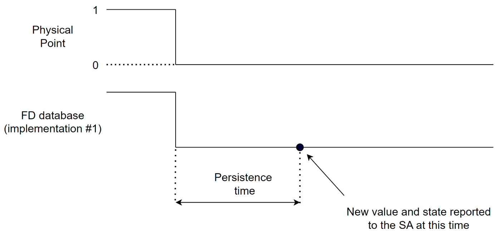

### Binary points

The term binary is used in this document to describe the point, and as the term "bi" and "bo" for binary input and binary output.

Table 11 describes the elements within the object: **binary**.

| **Information** | **Type** | **JSON Name** | **Mandatory** | **Description** |
|--------------|---------|--------------------------|------------|---------------------------------------|
| Parent Point | integer | parent | Yes | Binary features belong to binary parent points only. |
| Parent Point Type | string | parentType | Yes | "bi" or "bo" |
| Bit Count | integer | bits | No | Bit count, defaults to 1. Values are 1,2,3 only. |
| State 0 Action | integer | state0Action | No | 0=do nothing, 1=log data, 2=log data and connect to SA. |
| State 0 Persistence | integer | state0Pers | No | Persistence -- number of milliseconds the point must remain in this state before the action is taken. (Optional). |
| State 0 Name | string | state0Name | No | Name - name of state, may be used locally. (Optional). |
| State 1 Action | integer | state1Action | No | 0=do nothing, 1=log data, 2=log data and connect to SA. |
| State 1 Persistence | integer | state1Pers | No | Persistence -- number of milliseconds the point must remain in this state before the action is taken. (Optional). |
| State 1 Name | string | state1Name | No | Name - name of state, may be used locally. (Optional). |
| State 2 Action | integer | state2Action | No | 2=do nothing, 1=log data, 2=log data and connect to SA. |
| State 2 Persistence | integer | state2Pers | No | Persistence -- number of milliseconds the point must remain in this state before the action is taken. (Optional). |
| State 2 Name | string | state2Name | No | Name - name of state, may be used locally. (Optional). |
| State 3 Action | integer | state3Action | No | 0=do nothing, 1=log data, 2=log data and connect to SA. |
| State 3 Persistence | integer | state3Pers | No | Persistence -- number of milliseconds the point must remain in this state before the action is taken. (Optional). |
| State 3 Name | string | state3Name | No | Name - name of state, may be used locally. (Optional). |
| State 4 Action | integer | state4Action | No | 0=do nothing, 1=log data, 2=log data and connect to SA. |
| State 4 Persistence | integer | state4Pers | No | Persistence -- number of milliseconds the point must remain in this state before the action is taken. (Optional). |
| State 4 Name | string | state4Name | No | Name - name of state, may be used locally. (Optional). |
| State 5 Action | integer | state5Action | No | 0=do nothing, 1=log data, 2=log data and connect to SA. |
| State 5 Persistence | integer | state5Pers | No | Persistence -- number of milliseconds the point must remain in this state before the action is taken. (Optional). |
| State 5 Name | string | state5Name | No | Name - name of state, may be used locally. (Optional). |
| State 6 Action | integer | state6Action | No | 0=do nothing, 1=log data, 2=log data and connect to SA. |
| State 6 Persistence | integer | state6Pers | No | Persistence -- number of milliseconds the point must remain in this state before the action is taken. (Optional). |
| State 6 Name | string | state6Name | No | Name - name of state, may be used locally. (Optional). |
| State 7 Action | integer | state7Action | No | 0=do nothing, 1=log data, 2=log data and connect to SA. |
| State 7 Persistence | integer | state7Pers | No | Persistence -- number of milliseconds the point must remain in this state before the action is taken. (Optional). |
| State 7 Name | string | state7Name | No | Name - name of state, may be used locally. (Optional). |
| Control Pulse Time | integer | controlPulseTime | No | Control Pulse time (milliseconds) applies only to 1 bit binary output points. |
| Control Pulse Polarity | boolean | controlPulsePolarity | No | Control Pulse polarity applies only to 1 bit binary output points. If True, then the pulse is from 1 to 0 and back to 1. If False, then the pulse is from 0 to 1 and back to 0. |

: Configuration structure for a binary point

#### Multi-bit binary inputs and outputs

It is possible for binary inputs and outputs to be grouped together to provide a two-bit binary or three-bit binary. The "bits" parameter specifies the number of bits used from 1 to 3. If not specified, then 1 is implied. The point number refers to the least significant bit, and consecutive bits are more significant.

For example, a two-bit binary input using the number 8 will include number 9. When the data is read for this point, both bits are included, and the higher bits cannot be read. In this example bit number 9 is invalid.

For example, a three-bit binary input using the number 10 has the third, most significant, bit number 12.

#### Binary state persistence

The state persistence defines the number of milliseconds the point must remain in state \# before the state \# action is performed.

When multiple changes occur in one scan of I/O for a point (state, point quality flag or other changes) only a single action (the highest action of all the changes that occurred) is performed by the FD subject to the highest permitted action. This ensures only one action occurs for a single I/O scan.

When a binary point changes, an FD immediately updates its database with the new ***value*** of the point. When any configured persistence expires, and there are no further changes of the point, the FD reports the point change of state to the SA with its current ***value***. This implementation method means that any entity, such as the SA or local application programs, that accesses the FD's database before the persistence has expired, sees the new ***value*** of the point -- even though it may not have persisted for the configured time.

Figure 4 presents the diagrammatic view.

#### Pulsed controls

Only a 1 bit binary output point can support pulsed controls. The default pulse time is specified and is non-zero to indicate that pulsed controls are possible. The control pulse polarity field can be used to reverse the output pulse value so that it is normally on.
