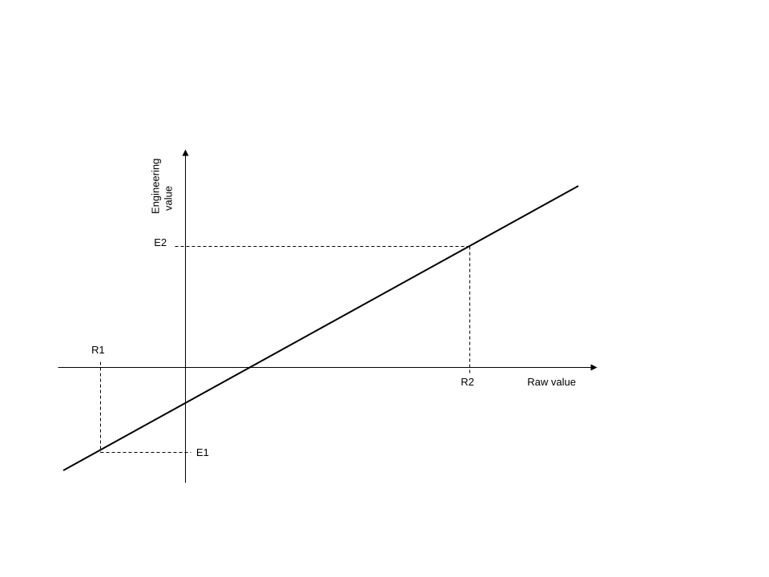

### Analogue points

Table 12 describes the elements within the object: **analogue**.

| **Information** | **Type** | **JSON Name** | **Mandatory** | **Description** |
|--------------|---------|-------------|------------|----------------------------------------------------|
| Parent Point | integer | parent | Yes | Analogue features belong to analogue parent points only. |
| Parent Point Type | string | parentType | Yes | "ai" or "ao" |
| Raw Scale 1 | Integer | rawsc1 | No | Raw Scale 1 is the first raw value of the point (e.g. lower or zero value for the instrument). |
| Raw Scale 2 | Integer | rawsc2 | No | Raw scale 2 is the second raw value for the scaling (e.g. higher or full scale value of the instrument). |
| Eng Scale 1 | number | engsc1 | No | Engineering Scale 1; this is the first engineering value that corresponds to the first raw value (e.g. smallest scaled output that can be reported. |
| Eng Scale 2 | number | engsc2 | No | Engineering scale 2; this is the second engineering value that corresponds to the second raw value (e.g. the highest scaled value that can be recorded). |
| Minimum | number | min | No | The measurement range's minimum value, in engineering units. If a value is below the minimum, then it is under-range. The OVER_RANGE flag must be set when reporting values that are under-range. Under-range values should not be used when determining significant data (dead-band) changes. |
| Maximum | number | max | No | The measurement range's maximum value, in engineering units. If a value is above the maximum, then it is over-range. The OVER_RANGE flag must be set when reporting values that are over-range. Over-range values should not be used when determining significant data (dead-band) changes. |
| Units | string | units | No | The units are a free format ASCII string that can be used when displaying the point value through local access displays etc. The FD should not interpret any meaning from this string and may choose to ignore it completely. |
| Significant Change Value | number | change | No | The value difference (a positive value) used to determine when the point has changed by a significant amount. |

: Configuration structure for an analogue point

#### Analogue point scaling

Analogue inputs and outputs and counters may be scaled. If no scale is defined, then a 1:1 scale with no offset is assumed.

Scaling is optional, and if these parameters are not used then the device reports its raw value.

Raw Scale 1 and Engineering Scale 1 are associated, as are Raw Scale 2 and Engineering Scale 2.

Figure 5 highlights the relationship.

The scaling values may be inverted such that Raw Scale 1 is greater than Raw Scale 2, or Engineering Scale 1 is greater than Engineering Scale 2, giving a graph with a negative slope.

The raw and engineering values need not be within the range for the point.

If scaling is not supported for a particular point, for example, a point whose value is fixed by the FD, then the FD rejects any configuration which is not 1:1 scaling.

Changing the scale of a point doesn't affect the range, limit values, and hysteresis defined for the point. For example, the SA can download a configuration containing limit records. Later, it may download a second configuration containing just a change to the scaling, but this does not affect the limits already stored from the earlier configuration. On the next I/O scan the point may change state due to the new engineering value being evaluated against the existing limits.

#### Range

Analogue points may have a valid range defined. See the fields **min** and **max**.

The value reported for an analogue point which is over or under range must be the over-range or under-range value. If a value reaches an instrumentation limit, then the instrumentation limit is reported.

A FD implements proprietary procedures to ensure it does not generate events that report fleeting changes of the Range Error point quality flag.

#### Units

Analogue points may have units defined. See the field **units**.

#### Significant change

Analogue points support the generation of events when point values differ from previous recorded values by a certain amount. These are known as significant change events.

A significant change event is generated when the absolute value of the difference between the last evented value and the current value of the point exceeds a set limit. The last evented value of the point must be the last value evented for a significant change. If no such value is available then the first recorded value of the point must be used, that is, the value when the Reset point quality flag is cleared. Significant change detection is performed on the scaled value of the point.

The significant change value is the non-negative change of point value that is considered to be significant. The significant change value is specified in engineering units, and the FD stores it in engineering units, not the equivalent raw value, so that it is not affected by any subsequent change to the scaling of the point.

A significant change value of 0 turns off significant change detection for that point.

Significant change detection must not be performed if the point has either the Restart or Range Error point quality flag asserted.

The action to be taken is described in Section [2.4](05-points-overview-and-quality.md#points), [Points](05-points-overview-and-quality.md#points). The **whenChange** property of the point determines the action.
