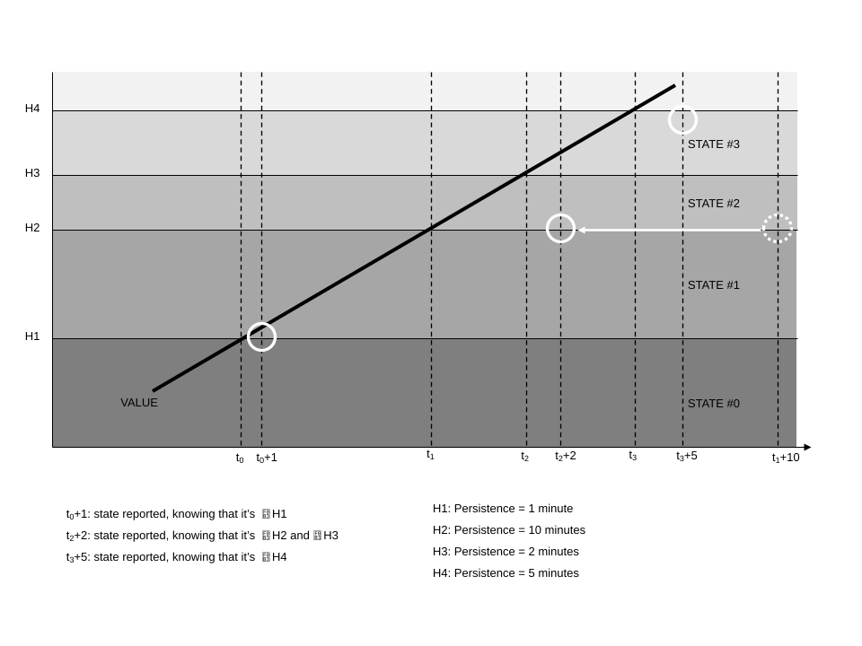
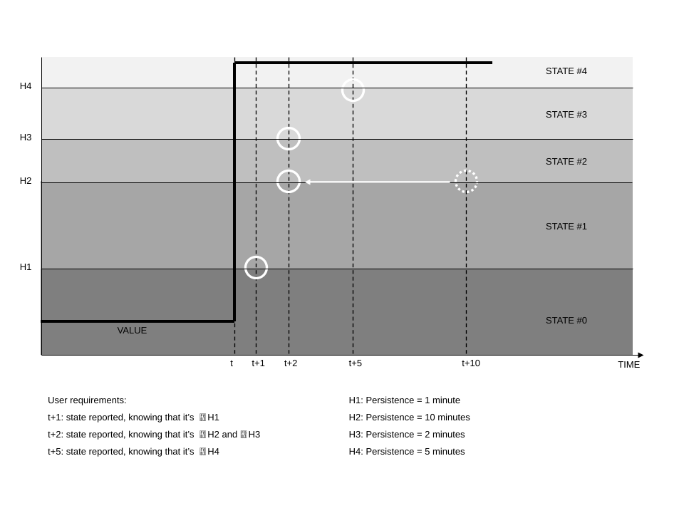

### Analogue limits

> Analogue points may have multiple states that are separated by limits. The properties of the limit control how and when transitions are made between states. A single point may have multiple limits and therefore multiple states. This section describes analogue limits and how they relate to states.
>
> The information in Table 14 is used to define limits for analogue points within the object: **analogueLimit**.

| **Information** | **Type** | **JSON Name** | **Mandatory** | **Description** |
|-----------------|---------|-------------|------------|-------------------------------------------------|
| Parent | Integer | parent | Yes | Analogue point number. |
| Parent Point Type | String | parentType | Yes | Type of point the limit refers to, "ai","ao","x". |
| Point Limit Index | Integer | num | Yes | Point Limit Index (PLI) for limit. |
| Name | String | name | No | A human readable name for the limit. |
| Action | Integer | action | Yes | Action to be taken on entering this state (0=do nothing, 1=log event with reason, 2=log event and trigger a connection to the SA). |
| Direction | Integer | dirctn | Yes | The direction for entering the state (0=positive going (low-normal-high, 1=negative going (high-normal-low )). |
| Limit Value | Number | value | Yes | The value of this limit, in engineering units. |
| Hysteresis | Number | hyst | No | Limit hysteresis, default 0. |
| Enter Persistence | Integer | enter | No | Limit entry persistence in milliseconds. |
| Leave Persistence | Integer | leave | No | Limit leave persistence in milliseconds. |
| Monday Profile | Integer | mon | No | Limit Profile number for Monday. |
| Tuesday Profile | Integer | tue | No | Limit Profile number for Tuesday. |
| Wednesday Profile | Integer | wed | No | Limit Profile number for Wednesday. |
| Thursday Profile | Integer | thu | No | Limit Profile number for Thursday. |
| Friday Profile | Integer | fri | No | Limit Profile number for Friday. |
| Saturday Profile | Integer | sat | No | Limit Profile number for Saturday. |
| Sunday Profile | Integer | sun | No | Limit Profile number for Sunday. |

: Information used in defining an analogue limit

For example:

```json
  "analogueLimit": [
    {
      "parent": 1,
      "parentType": "ai",
      "num": 1,
      "name": "High",
      "action": 2,
      "dirctn": 0,
      "value": 123.45,
      "sat": 1,
      "hyst": 1.0,
      "enter": 2000,
      "leave": 2000
    }
  ],
```

To configure multiple limits on the same point the configuration must contain multiple limit configuration records. An FD supports a change of state mechanism compatible with the diagram shown in Figure 6. Although values or combinations of values for direction, action, hysteresis, enter persistence, and leave persistence are optional, the record always contains every element.

If an element value or combination is not supported by the FD, then the SA must set these values appropriately. If a record contains unsupported values, then the FD must not accept the configuration. When an SA is configuring a sub-set of the limits on a point, it must ensure the limits do not invalidate existing limits. An SA may decide to download all the limits for a point even if some of the limits remain unchanged.

The following rules apply to all enabled limits for an individual analogue point. Disabled limits are ignored for the purposes of these rules and need not be present on upload.

- The limits must be set in ascending order of limit value with Point Limit Index (PLI) otherwise the FD rejects the configuration. When a profile is being used every day of the week there is no static limit value being used. In this case the unused limit value can contain any arbitrary value and must not be included in any validation checks done by the FD.

- Limits with a positive direction must have a higher PLI than limits with a negative direction, otherwise the FD rejects the configuration.

- Hysteresis should not cause an overlap, that is, hysteresis cannot artificially make limits that are not in ascending order with PLI, otherwise the FD rejects the configuration.

Figure 6 shows how the elements of the record are used to configure an analogue limit.


A state of an analogue point corresponds to the region between two adjacent limits, or the region above the highest limit, or the region below the lowest limit. The region between the lowest positive limit and highest negative limit is referred to as the normal state. If a point has no negative limits, then the normal state is for values below the smallest positive limit. If a point has no positive limits, then the normal state is for values above the largest negative limit. A point without any limits is always in the normal state.


For positive-going limits, that is, high limits, the range of values represented by a state includes the value of the lower bound, but not the value of the upper bound.

For negative-going limits, that is, low limits, the range of values represented by a state includes the value of the upper bound, but not the value of the lower bound.

For example, given a point with a negative limit at 20.0 and a positive limit at 80.0:

- The normal state represents values between 20.0 and 80.0 (exclusive).

- The high state represents values greater than or equal to 80.0.

- The low state represents values less than or equal to 20.0.

A point may enter a particular state because of exceeding either of the limits that bound the state.

When an FD supports a separate persistence per limit, then it also supports non-sequential persistence. Non-sequential persistence is where, for example, a series of positive limits have persistence times that get shorter when going positively from one limit to the next. Similarly, non-sequential persistence is where a series of negative limits have persistence times that get shorter when going negatively from one limit to the next. When a limit is exceeded and non-sequential persistence is configured, the action is performed on expiry of the shorter persistence time. Examples of non-sequential persistence are shown in Figure 8 and Figure 9.

| 🛈 | If an FD also supports separate enter state and leave state persistence, then both the enter state persistence and the leave state persistence may be non-sequential. For example, when the point changes from a low state to a high state (or vice versa) and the leave persistence time of the old state and enter persistence time of the new state are different, then the action is performed when the shorter of the two persistence times expires. |
|----|----|

When a point that has persistence configured changes state, the time stamp of the event is the time at which the persistence elapses, not the time at which the limit was initially exceeded.

Figure 8 illustrates the behaviour as an analogue point rises through four positive limits where the third limit's persistence is not sequential.



Figure 9 illustrates the behaviour as an analogue point step changes through four positive limits where the third limit's persistence is not sequential.



When an analogue point changes state, only the new state of the point is reported. Any intermediate states that may have been exceeded at the time in the change from the old state to the new state are not reported. This ensures that only a single event is generated or logged for each individual state change. For example, if a point has two high limits and changes from the normal state to the high-high state, then one event is generated or logged for entering the high-high state.

When multiple changes occur in one scan of I/O for a point, state, point quality flag or other changes, only the highest action of all the changes that occurred is performed by the FD, subject to the highest permitted action. This is to ensure only one action occurs for a single I/O scan.

If an FD only supports a single hysteresis or single persistence per point, then the SA must download the same hysteresis or persistence value for each limit per point. If the SA downloads different hysteresis or persistence, then the FD rejects the configuration. When the hysteresis or persistence is changed at the SA, it must download all the limits.

#### Point limit index

The Point Limit Index (PLI) defines which of the point's limits the record relates to and must be a valid limit for the FD.

The PLIs used by the FD must start from one and be consecutive. Also, PLI one must correspond to the lowest limit, and the maximum PLI must correspond to the highest limit. PLI zero is reserved to represent the normal state of a point. A maximum number of limits for each analogue point is declared in the SA Profile.

For example, an FD with four limits that have fixed directions may use the following PLIs:

- 1 -- Low-Low (LL)

- 2 -- Low (L)

- 3 -- High (H)

- 4 -- High-High (HH)

#### Direction

The Direction is the direction in which the point value is moving past the limit value to be entering the corresponding state. Options are:

- 0 for positive going, a high limit.

- 1 for negative going, a low limit.

The direction of each limit in an FD may be fixed, for example, HH, H, L, LL. In this case the SA must download these directions. The FD rejects any configuration with a different direction for a particular limit.

#### Limit value

The limit value defines the threshold for the limit. The limit value is in engineering units, and the FD must store it in engineer units, not the equivalent raw value, so that it is not affected by any subsequent change to the scaling of the point. The FD rejects any configuration that has the same Limit Value on adjacent Point Limit Indices.

When a profile is specified for a day of the week, it overrides the limit value for that day. When a profile is being used every day of the week then the limit value is not used and can contain any arbitrary value. In this case the FD must not perform any validation using the limit value.

#### Action

The Action defines the action to be taken on exceeding the limit in either direction; the action is as defined in Section [2.6](13-limit-and-control-profiles.md#limit-and-control-profiles), [Limit and control profiles](13-limit-and-control-profiles.md#limit-and-control-profiles).

When a point changes state, the action that is performed by the FD is determined by the highest configured action of the enabled limits that were exceeded as the result of the change:

- If any of these actions are configured as value 2, event and request connection, then the FD must create an event for the new state and assert **request to connect**, so the SA may raise or clear the required alarm(s).

- If none of these actions are configured as value 2, but any of them are configured as value 1, event, then the FD must store an event for the new state.

- Only if all these actions are configured as value 0 (do nothing), the FD performs no action.

When a point is on scan and any of the point quality flags change, the action for the flag must be performed subject to the highest permitted action, to report the new object flags. However, this does not apply until the Restart Point quality flag is cleared, and the state of the point determined.

In the following situations the highest action of all of the enabled limits and all of the point quality flags must be performed regardless of the highest permitted action. This highest action must also include any action configured for significant change of value reporting. This is required to report the current state of the point.

- At device start up and following a restart.

- When the point is put on scan.

- Following a configuration change to the action for any limit or any of the point quality flags.

- When a change in the configuration of the point's limits causes the point to change state.

The action is performed once the point has completed the next or initial scan of its I/O, that is, when the Restart Point quality flag is cleared, without applying hysteresis or persistence.

#### Hysteresis

The hysteresis is an adjustment made to the limit value to set a further level beyond which the point value must travel to leave the state. The value of hysteresis is always a positive number. The method by which the hysteresis is combined with the limit value to produce the leaving level is dependent on the limit direction.

- For positive going limits the hysteresis is subtracted from the limit value to create the leaving level.

- For negative going limits the hysteresis is added to the limit value to create the leaving level.

#### Enter persistence

The enter persistence defines the number of milliseconds the point value must have been beyond or equal to the limit value to enter the corresponding new state. The enter persistence is only used when a new limit state is entered with the point value moving away from the normal state.

#### Leave persistence

The leave persistence defines the number of milliseconds the point value must have been beyond the limit value with hysteresis to leave the current state and enter another state. The leave persistence is only used when a new limit state is entered with the point value moving towards the normal state.

#### Limit profile number

The Limit Profile numbers define the profiles to be used for the limit. This allows for different limits to be applied at different times of the day and on different days of the week. The profiles must have floating point values, and the FD rejects any configuration with a different type of value. For a fixed limit, no profile, use profile number zero.
