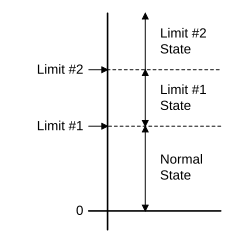

### Counter limits

Counters may have limits. When the counter exceeds those limits, events can be raised. It is possible to define multiple limits on counters. To configure multiple limits on the same point, the configuration must contain multiple limit configuration elements. When an SA is configuring a sub-set of the limits on a point, it must ensure they do not invalidate existing limits. An SA may decide to download all of the limits for a point even if some of the limits remain unchanged.

The following rule applies to all enabled limits for an individual counter point. Disabled limits are ignored and need not be present on upload.

| 🛈 | The limits must be set in ascending order of limit value with PLI otherwise the FD rejects the configuration. When a profile is being used every day of the week there is no static limit value being used. In this case the unused limit value can contain any arbitrary value and must not be included in any validation checks done in the FD. |
|--------------|-------------------------------------------------|

The state of a counter point corresponds to the region between two adjacent limits, or the region above the highest limit. The region between 0 and the lowest limit is referred to as the normal state. The range of values represented by a particular state includes the value of the lower bound, but not the value of the upper bound. A point without any limits is always in the normal state, see Figure 10.

For example, given a point with two limits at 20.0, high, and 40.0, high-high, the normal state represents values less than 20.0, the high state represents values greater than or equal to 20.0 and less than 40.0, and the high-high state represents values greater than or equal to 40.0.

The information in Table 15 is used to define limits for counter points within the object: **counterLimit**.

| **Information** | **Type** | **JSON Name** | **Mandatory** | **Description** |
|-----------------------|------------|--------|------------|----------------------------------------------|
| Parent Point | Integer | parent | Yes | Counter point number. |
| Point Limit Index | Integer | num | Yes | Point Limit Index (PLI) for limit. |
| Limit Name | String | name | No | A human readable name for the limit. |
| Action | Integer | action | Yes | Action to be taken on entering this state. |
| Limit Value | Number | value | Yes | The value of this limit. |
| Monday Profile | Integer | mon | No | Profile number for Monday. |
| Tuesday Profile | Integer | tue | No | Profile number for Tuesday. |
| Wednesday Profile | Integer | wed | No | Profile number for Wednesday. |
| Thursday Profile | Integer | thu | No | Profile number for Thursday. |
| Friday Profile | Integer | fri | No | Profile number for Friday. |
| Saturday Profile | Integer | sat | No | Profile number for Saturday. |
| Sunday Profile | Integer | sun | No | Profile number for Sunday. |

: Information used in defining a counter limit

If a counter point is cleared to 0 then the point enters the normal state.

When a counter point changes state, only the new state of the point is reported. Any intermediate states that may have been entered in the change from the old state to the new state are not reported. This ensures that only a single event is generated, or event logged for each state change. For example, if a point has two high limits and changes from the high-high state to the normal state, after being cleared to zero, then one data set must be generated, or event logged for entering the normal state.

When multiple changes occur in one scan of I/O for a point, state, point quality flag, or other changes, only the highest action of all the changes that occurred is performed by the FD subject to the highest permitted action. This is to ensure only one action occurs for a single I/O scan.

If counter rollover occurs, because of a point incrementing beyond the maximum possible counter value, then the FD must not generate an event, or log an event as a consequence of the rollover. Also, following a rollover the FD must not generate any further events or log any further events until the counter is cleared to 0.

#### Point limit index

The PLI defines which of the point's limits the record relates to and must be a valid limit for the FD.

The PLIs used by the FD must start from one and be consecutive. Also, PLI one must correspond to the lowest limit, and the maximum PLI must correspond to the highest limit. PLI zero is reserved to represent the normal state of a point. A maximum number of limits for each counter point is declared in the SA Profile.

For example, an FD with two limits may use the following PLIs:

- 1 -- High

- 2 -- High-High

#### Limit value

The limit value defines the threshold for the limit.

When a profile is specified for a day of the week, it overrides the limit value for that day. When a profile is being used every day of the week then the limit value is not used and can contain any arbitrary value. In this case the FD must not perform any validation using the limit value.

#### Action

The Action defines the action to be taken on exceeding the limit in either direction. The action is as defined in Section [2.6](13-limit-and-control-profiles.md#limit-and-control-profiles), [Limit and control profiles](13-limit-and-control-profiles.md#limit-and-control-profiles).

When a point changes state the action that is performed by the FD is determined by the highest configured action of the enabled limits that were exceeded as the result of the change:

- If any of these actions are configured as value 2, event and request connection, then the FD must create an event for the new state and assert **request to connect**, so the SA may raise or clear the required alarm(s).

- If none of these actions are configured as value 2, but any of them are configured as value 1, event, then the FD must store an event for the new state.

- Only if all these actions are configured as value 0, do nothing, will the FD perform no action.

When a point is on scan and any of the point quality flags change, the action for the flag must be performed subject to the highest permitted action, to report the new object flags. However, this does not apply until the Restart Point quality flag is cleared, and the state of the point determined.

In the following situations the highest action of all of the enabled limits and all of the point quality flags must be performed regardless of the highest permitted action. This highest action must also include any action configured for significant change of value reporting. This is required to report the current state of the point.

- At device start up and following a restart.

- When the point is put on scan.

- Following a configuration change to the action for any limit or any of the point quality flags.

- When a change in the configuration of the point's limits causes the point to change state.

The action is performed once the point has completed the next or initial scan of its I/O, that is, when the Restart Point quality flag is cleared, without applying hysteresis or persistence.

#### Profile number 

The profile numbers define the profiles to be used for the limit, to allow different limits to be applied at different times of the day and on different days of the week. The profiles must have floating point values, and the FD rejects any configuration with a different type of value. For a fixed limit, no profile, use profile number zero.
