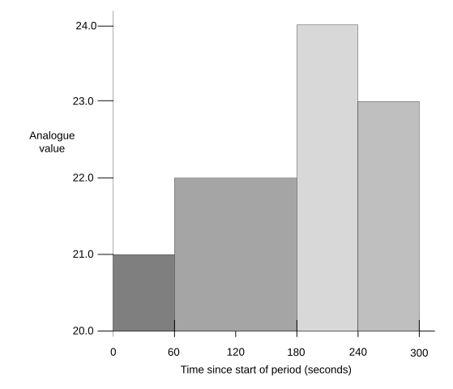

## Extended points

The protocol supports extended point types. An extended point is calculated from information taken from a source point.

Source points can be any binary, analogue or counter input, or binary or analogue output.

An extended point may present statistical, summary or event-based information for the source point. Apart from their method of calculation and how their point quality flags are set, extended points behave as for other points. They may be logged or have alarm limits associated with them. Rules applicable to extended point types are given below:

- For minimum, maximum, and mean, the stored value is the calculated value for the most recently completed calculation period. Therefore, the value in the extended point is only updated at the end of each period. This value then remains in the extended point until the end of the next period.

- For integral, state counter, and state runtime, the stored value is updated during the calculation period with the value being reset to 0 at the start of the next calculation period.

- Calculation is performed on source point values during the calculation period. These values are taken at the underlying default update rate for the source point or whenever logged values are requested for the source point.

- To remove an extended point, or stop calculation of the point, a full configuration which does not include the point is required.

- Only valid values are included in the calculation. The source point is deemed valid if the Offline Point quality flag is clear, and the Restart and Comms Lost flags are both clear. However, if the Local Forced flag is set, the point should convey valid data and may be considered in the calculation regardless of the other flags. The Remote Forced flag also indicates valid data provided that Offline is clear and Comms Lost is clear. Other combinations of these point quality flags indicate that the data is invalid.

- For minimum, maximum, and mean the point quality flags Range Error and Reference Error are a snapshot of the corresponding flags of the source point at the end of the time period, or at the time the event defining the extended point Max or Min occurred.

- For integral, state counter, and state runtime the point quality flags Range Error and Reference Error are the logical OR of the corresponding flags of the source point for all individual samples within the period.

- The extended point always has the Offline flag clear unless the source point was invalid for the entire sampling period.

- The Local Forced flag on the extended point indicates that the extended point itself has been overridden. The Remote Forced flag on the extended point is never set.

- When an extended point configuration is processed by the FD it must determine if there is a change being made to the configuration of the extended point's index. For any change of index, it should set the value of the extended point to the current value of the source point and set the extended point's Restart quality flag. This ensures that the value and flags set from any previous use of the point are not interpreted as pertaining to the newly calculated value.

- If the extended point is configured for periodic logging and the log period coincides with the end of a calculation period, then the FD should calculate the new value before the logging takes place. This is to ensure that the logged value is pertinent to the log period.

- To calculate an extended value of a point over an additional time period, the extended point used to store the initial extended value may itself have a further calculation provided the second calculation is synchronised with the first.

The information in Table 17 is used to define extended points within the object: **extPoint**.

| **Information** | **Type** | **JSON Name** | **Mandatory** | **Description** |
|--------------|---------|----------------|------------|--------------------------------------------------|
| Parent Point | Integer | parent | Yes | Parent point number. |
| Parent Point Type | String | parentType | Yes | Type of parent point the extension refers to, “ai”, “bi”, ”ao”, “bo”, ”x”, ”c”. |
| Extension Point Index | Integer | num | Yes | Extension point number (allowable numbers defined in the min/max/totalObjects). |
| Name | String | name | No | A human readable name for the point. |
| Class Name | String | className | No | The class is optional and is a string which can be used by the SA to denote equipment or asset ontology. |
| Extension Point Type | String | type | Yes | One of: "RoC" (Rate of Change), "Min", "Max", "Mean", "StdDev", "Integral", "Run Time", "Count" Run times count in 1 second units, scaled by the scaleFactorType of the extension. Counters count 1 per value change to 'state' value, also scaled. |
| Reset Period | integer | resetPeriod | No | Interval between resets of this extension's value calculation, in milliseconds). If zero or absent, then is not reset. |
| Reset Offset | integer | resetOffset | No | Offset from start of week (Monday) in milliseconds. |
| Report Period | integer | reportPeriod | No | Interval between reports of this extension's value. In milliseconds, starting at reset with last accumulated value. |
| Scale Value | number | scale | No | Multiplies raw value to get value of extension. |
| State Mask | integer | stateMask | No | Increment the Run Time or Count when the source point state matches a state set in this bit mask. Only applies to Run Time or Count. Bit 0 is state 0, bit 1 state 1 and so on. A state mask of 0 will result in no Run Time or Count updates. |
| Units | string | units | No | The units are a free format ASCII string that can be used when displaying the point value through local access displays etc. The FD should not interpret any meaning from this string and may choose to ignore it completely. |

: Information used in defining extended points

The Report and Reset values are indicated by the relevant Reason value in the reported data.

### Minimum

The minimum extended point is an analogue input which captures the minimum value of a source analogue point over a given time period.

The reset period is the time in milliseconds over which the minimum is calculated.

The offset is the number of milliseconds from the start of the week to which the reset period must be synchronised.

The report period is the time in milliseconds between logging values. The minimum value may therefore go lower in successive reports until reset.

### Maximum

The maximum extended point is an analogue input which captures the maximum value of a source analogue point over a given time period.

The reset period is the time in milliseconds over which the maximum is calculated.

The offset is the number of milliseconds from the start of the week to which the reset period must be synchronised.

The report period is the time in milliseconds between logging values. The maximum value may therefore go higher in successive reports until reset.

### Mean

The mean extended point is an analogue input which captures the mean value of a source analogue point over a given time period.

The reset period is the time in milliseconds over which the mean is calculated.

The offset is the number of milliseconds from the start of the week to which the reset period must be synchronised.

The report period is the time in milliseconds between logging values. The mean value is therefore calculated from the reset time to the report time.

### Standard deviation

The standard deviation extended point is an analogue input which calculates the Population standard deviation of the input.

The reset period is the time in milliseconds over which the deviation is calculated.

The offset is the number of milliseconds from the start of the week to which the standard deviation reset period must be synchronised.

The report period is not used.

### Integral

The integral extended point is an analogue input which captures the integrated value of a source analogue point over a given time period.

The reset period is the time in milliseconds over which the integral is calculated.

The offset is the number of milliseconds from the start of the week to which the integral reset period must be synchronised.

The integral is the sum of a series of analogue values, each multiplied by the elapsed time (in seconds) since the preceding value.

The report period is the time in milliseconds between logging values. The integral value is therefore calculated from the reset time to the report time.

The analogue values used when calculating the integral should be chosen in such a way that they give the most accurate result for the particular FD and I/O.

For example, if an FD periodically samples the current value from its I/O then it can use the mid-value (average) between consecutive samples.

In Figure 11, the integral is calculated over a period of 5 minutes.

Using the analogue values shown in the example the integral would be as follows:

(21.0 × 60) + (22.0 × 120) + (24.0 × 60) + (23.0 × 60) = 6720.0

The value stored in the virtual point is the integral since the start of the current calculation period. At the start of the next reset period, this value is reset to zero.

### Rate of change

Analogue and counter points may support Rate of Change (ROC) detection. The ROC is calculated over a period of time and then scaled to a specified time base with the results stored in an extended analogue input point, which can then have events configured.

ROC detection is performed on the scaled value of the source point.

The ROC reset period is the time in milliseconds that the point must remain within the deadband to cause the event to occur. An ROC period of 0 turns off ROC detection.

The ROC timebase is the number of milliseconds over which the ROC is scaled in the calculation.

The ROC point number is the index of an extended analogue input that is used only to store the calculated ROC of the analogue or counter point. If a counter point rolls over during a ROC period, then the FD must compensate when calculating the ROC. The following algorithm is used to calculate the ROC:

$$\frac{new\, value\, - \, old\, value}{ROC\, period} \cdot \, ROC\, timebase$$

Where *new value* is the current value of the point and *old value* was the value of the Point *ROC period* milliseconds earlier. For example:

$$\frac{12.0\, mm\, - \, 9.0\, mm}{30,000\, ms} \cdot 60,000\, ms = \ Rising\ by\ 6.0\ mm\ per\ minute$$

The ROC is negative if the value is falling, positive if the value is rising and zero if unchanged over the defined period.

Only valid values are included in the derivation. The source point is deemed valid if the Offline Point quality flag is clear, and the Restart and Comms lost flags are both clear. However, if the Local Forced flag is set, the point should convey valid data and may be considered in the calculation regardless of the other flags. The Remote Forced flag may also indicate valid data provided that Offline is clear and Comms Lost is clear. Other combinations of the point quality flags indicate that the data is invalid.

No attempt is made to capture any of the source point quality flags into the extended point quality flags.

The ROC extended point always has the Offline Point Quality flag clear if the source point was valid at the start and end of the sampling period.

The Local Forced flag on the ROC derived point indicates that the extended point itself has been overridden. The Remote Forced flag on the extended point is never set.

When ROC configuration is processed by the FD it must determine if there is a change being made to the configuration of the extended point. For any change of the ROC extended point number it should set the value of the extended point to zero and assert the extended point's Restart quality flag. This ensures that the value/state and flags set from any previous use of the points are not interpreted as pertaining to the ROC value indication.

If the ROC extended point is configured for periodic logging and the log period coincides with the end of a calculation period, then the FD should calculate the new value before the logging takes place. This is to ensure that the logged value is pertinent to the log period.

The ROC periods should be synchronised to the reset offset.

The action to be taken is as described in Section [2.6](13-limit-and-control-profiles.md#limit-and-control-profiles), [Limit and control profiles](13-limit-and-control-profiles.md#limit-and-control-profiles).

The report period is not used.

### State counter

Binary, analogue, and counter points all support state change counting. The state counter extended point is a count of the number of times the point's state has been changed to one of a selected set of states within a given time period. The count is stored in the state counter extended analogue point.

The Type field is **Count**.

The reset period is the time in milliseconds over which the count is calculated.

The reset offset is the number of milliseconds from the start of the week to which the count period must be synchronised.

The state mask defines which states of the point are to be counted. The mask has 1-bit per state, with bit 0 corresponding to state 0, bit 1 to state 1 and so on. For example, a state mask of 0x0005 counts the number of times a double-bit binary input point changes to state 0 or state 2 within the defined period.

To disable the state counter on the point, specify a state mask of zero.

The extended point value is the number of times the point enters one of the selected states within the given time period.

The report period is the time in milliseconds between logging values. The counter value is therefore calculated from the reset time to the report time.

### State runtime

Binary, analogue, and counter points all support state runtime calculation. The state runtime extended point is time within a given time period that a point was in one of a selected set of states. The time is stored in the state runtime extended analogue point.

The Type field is **Run Time**.

The reset period is the time in milliseconds over which the time is calculated.

The reset offset is the number of milliseconds from the start of the week to which the runtime period must be synchronised.

The state mask defines which states of the point are to be included in the count of time. The mask has 1-bit per state, with bit 0 corresponding to state 0, bit 1 to state 1 and so on. For example, a state mask of 0x0005 calculates the time that a double-bit binary input point has been in state 0 or state 2 within the defined period.

To disable the state runtime on the point, specify a state mask of zero.

The extended point value is the time in milliseconds that the point has been in one of the selected states within the given time period.

The report period is the time in milliseconds between logging values. The runtime value is therefore calculated from the reset time to the report time.
