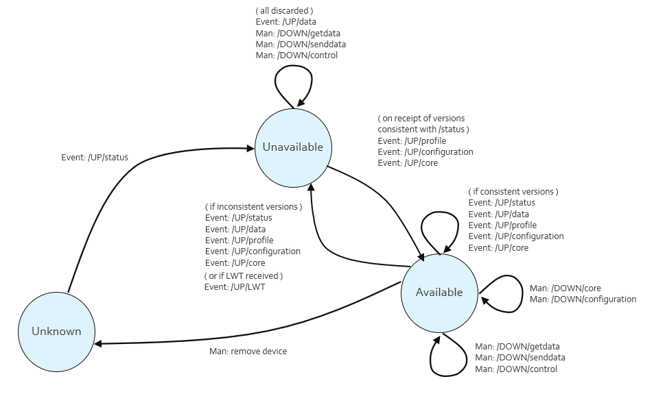

# Field device lifecycle

Figure 12 shows the connection state model.



The status message block gives the status information needed for the sections below. This includes the Node ID which can be configured locally to the FD and aids device replacement.

## Status message

The FD sends the status message on connection to the MQTT Broker.

The status message for the protocol uses the Topic name:

\[UUID\]/UP/status

The QoS is 2, RETAIN is 1.

The status message contains reference information about the Profile and Configuration version. It is sent on every connection, and when the data contained has changed. The status message refers to the following separate elements which are not part of the status message:

- Field Device Profile\
  This declares the capability of this range of physical devices. It lists all the available features including the way in which they may be configured. It does not include any configuration. It can be uploaded to the SA, not downloaded. The content of the FD Profile may be a reference to a stored profile rather than the profile itself, in order to save bandwidth, in which case the status message contains that reference and there is no transmitted Device Profile message.

- Core Block(s)\
  This can be the device firmware, a device configuration image, or separate application data, and can consist of one or more opaque, usually binary, images. These can be optionally uploaded or downloaded. The term block is used rather than file. An active property indicates the status of the block.

- Field Device Configuration\
  This is a file which carries configuration data and is conformant to the capabilities of the FD Profile. This can be optionally uploaded or downloaded from SA to FD or FD to SA.

The Status message contains:

```json
  {
 // Field Device Profile Reference (text). 
 // By convention the format is Manufacturer, Field Device Name,
 // Version. Underscores separate the parts of the name, hyphens 
 // separate version number parts.
 // Forward or back slashes or periods are not permitted. 
  "pRef":"ACME_RTUOne_1-23",
 // Core Block version(s) (text) -- array of names and versions, 
 // may be an empty array if not present or may be omitted 
 // altogether. The first Status message from the FD will contain 
 // this field, if applicable, and subsequent message may omit it
 // if unchanged. The names are arbitrary and device-specific. 
 // If the Required "req" flag is true, then the device is 
 // requesting that file, either because it is a new device or has 
 // a fault with its current version.
  "core":[
    {"name":"Firmware",
     "ver":"2.3"},
    {"name":"Program 1",
     "ver":"A", 
     "req": true, 
     "active":false}
  ],
 // Configuration version (numeric) -- may be blank if not present. 
 // This is the version of the configuration settings data, and is
 // managed and incremented by the device. Must match any 
 // configuration sent from FD to SA.
  "cVer":123,
 // Configuration Required from SA (default 
 // false if not required).
 // If some received and processed configuration places the device
 // into an error state, this will be true.
  "cReq":true,
 // If a configuration message was received and processed 
 // successfully by the FD and a "source" string was received in 
 // that message, then the first Status message from the FD will
 // contain this source string.
  "source":"62d18075-e5e2-49c2-89e2-abd1cc8025af",
 // Time Required from SA (default false if not required).
 // Requires the clock set command attribute in the profile.
  "timeReq":true,
 // Optional text concerning state of configuration, e.g. message 
 // explaining problems. Default is an empty string or not 
 // present.
  "cState":"",
 // Optional state of the device -- whether it is actively 
 // monitoring and available for controls. Default is false. 
 // A device may report this is true until it receives valid 
 // configuration.
  "inactiveState":true,
 // Node identification -- an optional unique string used for 
 // device replacement scenarios. I.e. an SA could use this to 
 // enable replacement of devices with different UUID but 
 // the same "nid". Must match any configuration sent from
 // FD to SA. The SA may use this to determine the desired 
 // configuration to send, if cReq is true.
  "nid":"123ABC",
 // Date and Time this message was created.
  "time":1697613172001
  }
```

A typical example of this message is shown here (with added spacing):

```json
  {
    "pRef":"ACME_RTUOne_1-23",
    "core":[
      {"name":"Firmware","ver":"2.3"},
    ],
    "cVer":42,
    "time":1697613172001
  }
```

Core block file version identification text is arbitrary, that is, the protocol does not mandate a version syntax, or that version numbers must increment. The FD specifies through its Status message that files are required, although the SA can independently force updates down to the FD if downloads are supported. Complete core block files are uploaded or downloaded, though not necessarily in a single message.

The FD Configuration version cVer uses ascending version number integers, which, if the SA and FD have different versions and the Required flag is false, the SA determines which to upload or download by reference to the later version number. The FD Configuration can optionally be sent from SA to FD and is mandatory from FD to SA.

## Last Will and Testament

Use of the Last Will and testament (LWT) is optional. The LWT provides a presence indication which is compatible with MQTT.

Each client can optionally specify its LWT, a normal MQTT message with Topic, retained flag, QoS and payload, when connecting to a Broker. The Broker stores the message until it detects that the client has disconnected ungracefully. If the client disconnects abruptly, the Broker sends the message to all subscribed clients on the Topic, which was specified in the LWT.

The LWT for the protocol uses the Topic name:

\[UUID\]/UP/lwt

The QoS is 2, and the message is:

```json
{"state":"Fault", "time":1694773266000}
```

The text of the state is device specific. The time is set by the FD when the LWT is created.

## Field device replacement

FDs may need to be replaced on-site, due to battery changes, upgrades, or hardware failure. To cover this situation, the device Node ID (NID) is transferred from the old device to the new. The new device then begins to communicate with the SA.

The device can be fully configured locally by the on-site staff or may require configuration to be pushed down to the device from the SA. In the latter case the device presents an existing NID in its Status message but coming from a new UUID. The SA can either accept the new device silently or require user input to accept the replacement device as the new FD. The SA may be able to reliably verify identity using cryptographic methods.

SA behaviour in this case is beyond the scope of the communications protocol.
